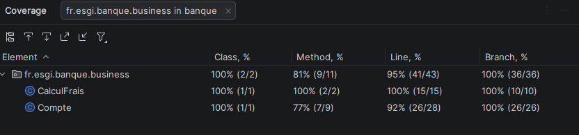
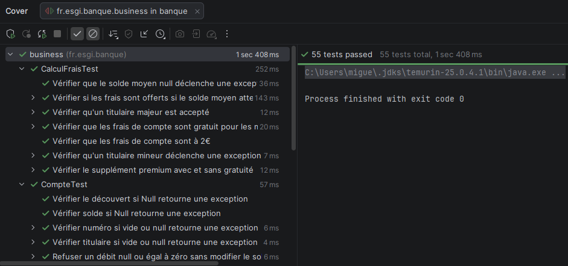

# Rendu Tests unitaires et TDD

- **Nom :** Lopes
- **Prénom :** Miguel
- **Campus :** Reims

## Partie A : Défauts trouvés et corrigés

### C3 : Refus des crédits de zéro

**Défaut :** la méthode `Compte.crediter` refusait les montants négatifs, mais acceptait zéro, alors que le montant doit être strictement positif.

**Correction :** remplacer la condition `montant.signum() < 0` par `montant.signum() <= 0`. Le contrôle existant du montant `null` est conservé.

**Test qui prouve le défaut :** `CompteTest.verifierCreditDeZeroRetourneUneException`.

### C5 : Débit atteignant exactement la limite du découvert

**Défaut :** la méthode `Compte.debiter` refusait un débit lorsque le nouveau solde était exactement égal à l'opposé du découvert autorisé. Par exemple, avec un solde de 100 € et un découvert autorisé de 200 €, un débit de 300 € était refusé à tort.

**Correction :** remplacer `nouveauSolde.compareTo(decouvertAutorise.negate()) <= 0` par une comparaison strictement inférieure à zéro. Le solde peut ainsi atteindre exactement -200 € dans cet exemple.

**Test qui prouve le défaut :** `CompteTest.VerifierSiSoldePasseAuMaxDuDecouvertAutoriseNeRetournePasUneErreur`.

### C6 : Reconnaissance de zéro indépendamment de son écriture

**Défaut :** la méthode `Compte.estVide` utilisait `BigDecimal.equals`, qui tient compte de la valeur et de l'échelle. Un solde écrit `0.00` n'était donc pas reconnu comme égal à `BigDecimal.ZERO`.

**Correction :** utiliser `solde.compareTo(BigDecimal.ZERO) == 0` pour comparer uniquement les valeurs numériques.

**Test qui prouve le défaut :** `CompteTest.VerifierFonctionEstVideRetourneTrueQuandLeSoldeEstA0`.

### F3 : Fin de la gratuité à 26 ans

**Défaut :** la condition `ageTitulaire <= AGE_JEUNE` accordait encore la gratuité des frais de tenue de compte à 26 ans. La règle la réserve aux titulaires de moins de 26 ans.

**Correction :** utiliser `ageTitulaire < AGE_JEUNE`.

**Test qui prouve le défaut :** `CalculFraisTest.VerifierFraisDeCompteGratuitPourMoinsDe26Ans`.

### F4 : Gratuité dès 1 000 € de solde moyen

**Défaut :** la comparaison `soldeMoyen.compareTo(SEUIL_GRATUITE) > 0` excluait le seuil exact de 1 000 € de la gratuité.

**Correction :** utiliser `soldeMoyen.compareTo(SEUIL_GRATUITE) >= 0`.

**Test qui prouve le défaut :** `CalculFraisTest.VerifierFraisOffertsPourSoldeMoyenDe1000`.

### F5 : Maintien du supplément premium lorsque la tenue est offerte

**Défaut :** les retours anticipés de `CalculFrais.fraisMensuels` renvoyaient zéro dès qu'une condition de gratuité était remplie. Le supplément premium de 5 € n'était alors pas ajouté, bien qu'il soit toujours dû.

**Correction :** calculer les frais de tenue de compte, les ramener à zéro si l'âge ou le solde moyen donne droit à la gratuité, puis ajouter le supplément premium lorsque la carte est présente.

**Test qui prouve le défaut :** `CalculFraisTest.VerifierSiFraisCartePremiumSappliquePourPlusDe1k`.

## Validation et couverture de code

### Partie A : Compte et CalculFrais

